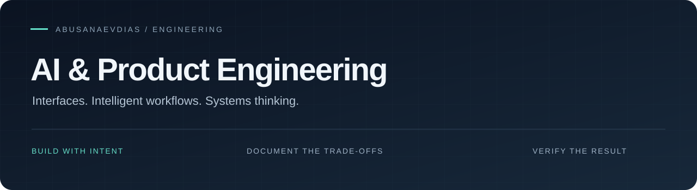

  <a href="#projects">Projects</a> &nbsp;·&nbsp;
  <a href="#engineering-library">Engineering library</a> &nbsp;·&nbsp;
  <a href="./repository-review.md">15 repository reviews</a>

## Focus

A workspace for TypeScript product interfaces and practical AI engineering research: agent workflows, retrieval, evaluation and reliable application boundaries.

The aim is simple: make the product useful, the architecture understandable and the result verifiable.

## Projects

| Project | Product scope | Technical focus |
| :--- | :--- | :--- |
| [ASHYQ Diagnostic](https://github.com/abusanaevdias/ashyq-diagnostic) | IELTS/SAT quick-diagnostic web application with result and lead-capture flows. Its estimates are preliminary, not official exam scores. | TypeScript, Next.js, React; question-bank validation and application checks are defined in the repository. |
| [Yummy Admin](https://github.com/abusanaevdias/yummy) | Admin-interface prototype covering dashboard, branches, orders, employees and box templates. | React, TypeScript, Vite, Tailwind CSS and Recharts. Current source uses mock data. |

[ASHYQ application URL](https://ashyq-diagnostic.vercel.app) · Application availability and individual features may change; the repository is the source for implementation scope.

## Engineering library

Fifteen upstream repositories selected by engineering purpose. Each review explains a use case, an architectural trade-off and a concrete verification plan.

| Area | Selected references |
| :--- | :--- |
| Application foundations | [Full Stack FastAPI Template](https://github.com/fastapi/full-stack-fastapi-template), [React](https://github.com/react/react) |
| Agent workflows | [Pydantic AI](https://github.com/pydantic/pydantic-ai), [LangGraph](https://github.com/langchain-ai/langgraph) |
| Documents and retrieval | [LlamaIndex](https://github.com/run-llama/llama_index), [Qdrant](https://github.com/qdrant/qdrant), [pgvector](https://github.com/pgvector/pgvector) |
| Evaluation and ML | [Promptfoo](https://github.com/promptfoo/promptfoo), [scikit-learn](https://github.com/scikit-learn/scikit-learn) |
| Models and demonstrations | [Transformers](https://github.com/huggingface/transformers), [Ollama](https://github.com/ollama/ollama), [Streamlit](https://github.com/streamlit/streamlit), [Gradio](https://github.com/gradio-app/gradio) |
| Engineering practice | [System Design Primer](https://github.com/donnemartin/system-design-primer), [Ruff](https://github.com/astral-sh/ruff) |

[Read the engineering reviews →](./repository-review.md)

## Quality bar

- **Explicit boundaries:** separate the interface, application rules, data access and model/provider calls.
- **Inspectable answers:** preserve sources, identify missing information and test unsupported questions.
- **Reliable actions:** use clear permissions, bounded retries and idempotency around external side effects.
- **Evidence before claims:** distinguish a source review, a local check, a deployment and a measured product result.

About the open-source references

Original software belongs to the linked upstream authors. Study forks retain upstream history, documentation and licenses. The portfolio layer adds engineering notes; it does not claim authorship of these frameworks or accepted upstream contributions.

The reviews are documentation and proposed verification plans. They are not benchmarks or claims that all upstream runtime suites have been executed.

