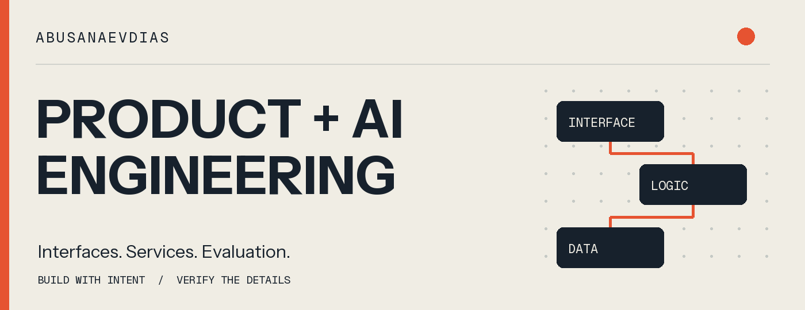
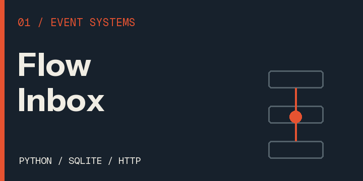
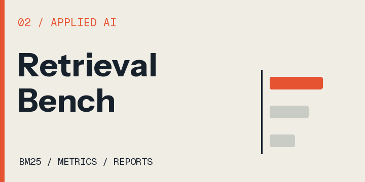
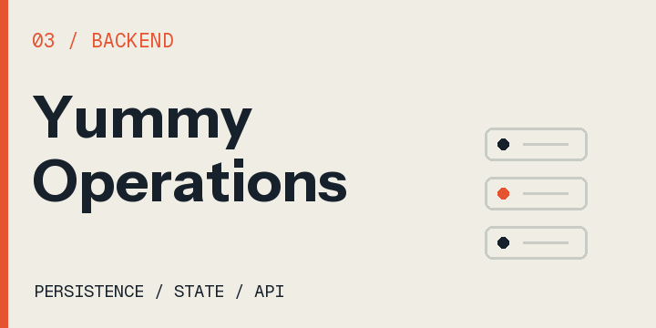
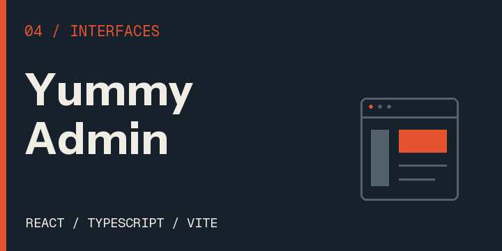

I build TypeScript interfaces and Python services, with a focus on retrieval evaluation and reliable application workflows.

The three Python projects below are **independently runnable local demos** with synthetic fixtures. Yummy Admin is a separate UI prototype using mock data.

<table>
  <tr>
    <td width="50%" valign="top">
      
      
<a href="https://github.com/abusanaevdias/flow-inbox"><strong>Flow Inbox</strong></a> SQLite event intake with idempotency, expiring leases, bounded retries, and inspectable history.

    </td>
    <td width="50%" valign="top">
      
      
<a href="https://github.com/abusanaevdias/retrieval-bench"><strong>Retrieval Bench</strong></a> BM25 retrieval, explicit relevance judgments, and reproducible JSON/HTML evaluation reports.

    </td>
  </tr>
  <tr>
    <td width="50%" valign="top">
      
      
<a href="https://github.com/abusanaevdias/yummy-operations-api"><strong>Yummy Operations API</strong></a> Idempotent reservations, immutable order snapshots, and explicit state transitions backed by SQLite.

    </td>
    <td width="50%" valign="top">
      
      
<a href="https://github.com/abusanaevdias/yummy"><strong>Yummy Admin</strong></a> React/TypeScript operations interface with mock data. It is not connected to the separate Operations API.

    </td>
  </tr>
</table>

**Engineering focus:** clear interfaces, explicit state, reproducible tests, and documented trade-offs. Local checks and implementation evidence are recorded in the [build log](./BUILDLOG.md).

<strong>Engineering library · 15 attributed study forks</strong>

These forks retain upstream authorship, history, and licenses. My additions are engineering notes covering use cases, architecture, trade-offs, and proposed verification. Source reviews do not imply accepted upstream contributions or execution of every upstream test suite.

| Area | Study forks |
| :--- | :--- |
| Application foundations | [Full Stack FastAPI Template](https://github.com/abusanaevdias/full-stack-fastapi-template), [React](https://github.com/abusanaevdias/react) |
| Agent workflows | [Pydantic AI](https://github.com/abusanaevdias/pydantic-ai), [LangGraph](https://github.com/abusanaevdias/langgraph) |
| Documents and retrieval | [LlamaIndex](https://github.com/abusanaevdias/llama_index), [Qdrant](https://github.com/abusanaevdias/qdrant), [pgvector](https://github.com/abusanaevdias/pgvector) |
| Evaluation and ML | [Promptfoo](https://github.com/abusanaevdias/promptfoo), [scikit-learn](https://github.com/abusanaevdias/scikit-learn) |
| Models and demonstrations | [Transformers](https://github.com/abusanaevdias/transformers), [Ollama](https://github.com/abusanaevdias/ollama), [Streamlit](https://github.com/abusanaevdias/streamlit), [Gradio](https://github.com/abusanaevdias/gradio) |
| Engineering practice | [System Design Primer](https://github.com/abusanaevdias/system-design-primer), [Ruff](https://github.com/abusanaevdias/ruff) |

[Build log](./BUILDLOG.md) · [Asset notices](./ASSET-NOTICES.md)
